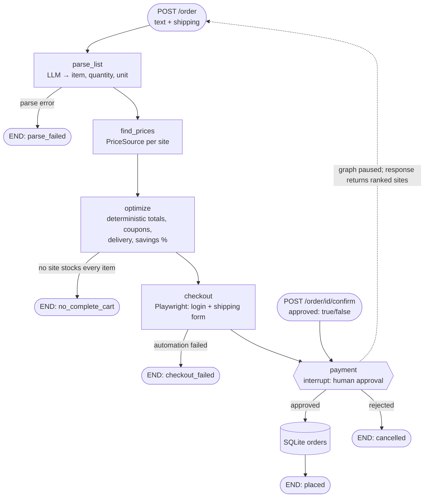

# project-with-devin — multi-agent shopping system

A LangGraph + LangChain agent that turns a free-text grocery list into a price comparison across
several (mock) grocery sites, picks the cheapest cart after coupons and delivery, fills the
checkout form with a Playwright browser agent, and **waits for a human to approve payment**
before recording the order in SQLite.

## Agent flow



| Node | Module | Notes |
| --- | --- | --- |
| `parse_list` | `shopping_agent/parser.py` | `ChatOpenAI` prompt → JSON, validated into `ListItem` (`item`, `quantity`, `unit` ∈ kg/g/l/ml/pcs/dozen/pack). Without `OPENAI_API_KEY` it falls back to a rule-based parser so the demo runs offline. |
| `find_prices` | `shopping_agent/price_sources/` | Pluggable `PriceSource` interface. `MockPriceSource` serves static INR data for **QuickMart**, **FreshBuy** and **ValueStore** (prices, stock gaps, coupons, delivery fees). `playwright_scraper.py` and `api_source.py` are adapter stubs with `TODO(real-source)` notes. |
| `optimize` | `shopping_agent/optimizer.py` | Pure Python. Per site: subtotal, best single coupon (coupons don't stack; chosen to minimize the final total incl. delivery), delivery fee, total. Sites missing an item aren't ranked. Savings % is vs. the most expensive complete cart, e.g. `Buy from ValueStore — save 15.8%`. |
| `checkout` | `shopping_agent/checkout.py` | `PlaywrightCheckoutAgent` logs in and fills first name / last name / address on the local mock shop (`/mock-shop/{site}/…`), stops on the review page and saves a screenshot to `artifacts/`. It never places the order. |
| `payment` | `shopping_agent/graph.py` | `langgraph.types.interrupt(...)` pauses the graph. Only an explicit `{"approved": true}` resume records the order; anything else cancels. Checkpoints persist in SQLite, so pending approvals survive restarts. |

## Setup

Requires Python 3.10+.

```bash
python3 -m venv .venv
.venv/bin/pip install -r requirements.txt
.venv/bin/playwright install chromium        # add --with-deps on a fresh Linux box
cp .env.example .env                         # then set OPENAI_API_KEY (optional for the demo)
```

Configuration lives in `.env` (see `.env.example`); no secrets are read from code.
Set `CHECKOUT_MODE=skip` to bypass the browser step.

## Run

```bash
.venv/bin/python app.py      # http://localhost:5000, interactive docs at /docs
```

Create an order (runs parse → prices → optimize → checkout, then pauses for approval):

```bash
curl -s -X POST localhost:5000/order -H 'content-type: application/json' -d '{
  "text": "sugar 2 kg, rice 5 kg",
  "shipping": {"first_name": "Asha", "last_name": "Rao", "address": "12 MG Road, Bengaluru"}
}'
```

The response has `status: "awaiting_approval"`, the ranked `comparison`, the `recommendation`
and `pending_approval` (site, total, coupon). Approve or reject payment:

```bash
curl -s -X POST localhost:5000/order/<order_id>/confirm \
  -H 'content-type: application/json' -d '{"approved": true}'   # or false
```

`approved` is required; confirming an order that isn't awaiting approval returns `409`.
`GET /order/<order_id>` shows the current state. Placed orders are in `data/orders.sqlite`.

## Tests

```bash
.venv/bin/pytest -q
```

- `tests/test_parser.py` — parser output schema (LLM path via a fake chat model, and the fallback).
- `tests/test_optimizer.py` — coupon rules, delivery thresholds, ranking and savings math.
- `tests/test_api.py` — graph + API: pauses for approval, records only on explicit approval.
- `tests/test_checkout_e2e.py` — Playwright agent against the mock shop (skipped if Chromium isn't installed).

## Adding a real price source

Implement `PriceSource.quote(items) -> SiteQuote` (see the stubs in `shopping_agent/price_sources/`)
and pass it to `build_graph(price_sources=[...])` in `shopping_agent/graph.py`. Prefer official or
partner APIs; if scraping, respect the site's Terms of Service and robots.txt. Read any credentials
from environment variables.
